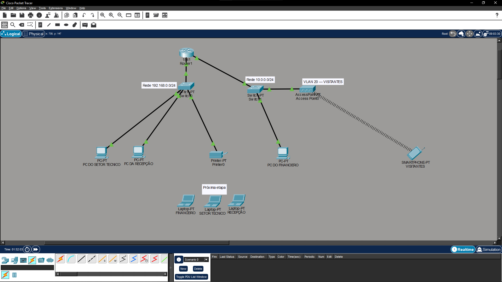

# CORPORATE NETWORK LAB 

Laboratório de redes criado no Cisco Packet Tracer.

Objetivo:
Simular uma rede corporativa com VLANs, roteamento e WI-Fi para visitantes.

## ARQUITETURA DE REDE

O roteador central conecta dois switches, um para rede interna e um para visitantes com Acess Point.
